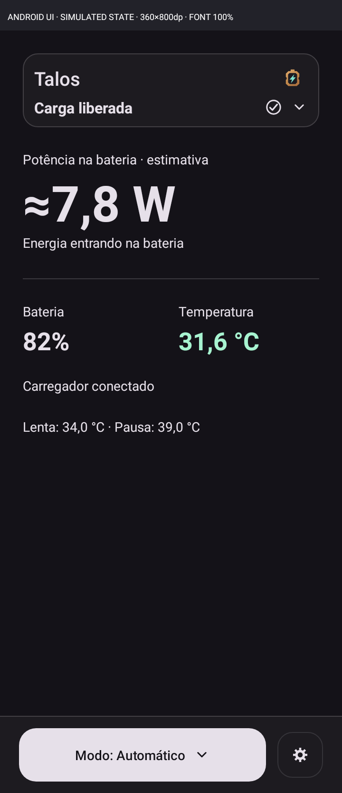

# Talos Battery Control

Battery monitoring and charging controls for supported Samsung Galaxy devices.
Named after Talos, the bronze guardian of Crete.

**[Download Debug 46](https://github.com/brenopoubel0324/TalosBatteryControl-Releases/releases/tag/v6.0.0-beta.13)**

This public repository contains official APK downloads, update metadata and
product documentation. Application source and development history remain private.

## Installation

Install the official APK as an update without uninstalling the previous version.
Package and signing certificate are preserved. Current downloads are test previews.
Android asks for installation confirmation; the app does not install silently.

## Compatibility

Battery temperature and power estimates do not need Shevery or Shizuku. Changing
charging settings requires the appropriate access and Samsung firmware support.
An emulator cannot confirm the electrical effects of Samsung charging controls.

Android/Robolectric rendering from Debug39 with simulated readings, not a physical
Samsung capture.

## Update channels

The debug catalogue is channels/debug.json. The stable catalogue is currently
empty. VersionCode, variant, package, digest and certificate identify an offer.
Debug 46 can check for, download and verify updates in Settings → About.
Debug 39 users can update using the APK linked above.

## Support and notices

[Report an issue](https://github.com/brenopoubel0324/TalosBatteryControl-Releases/issues).
Please avoid personal information in screenshots or diagnostics.
[Terms](TERMS.md) · [Third-party notices](licenses/NOTICE.txt).
